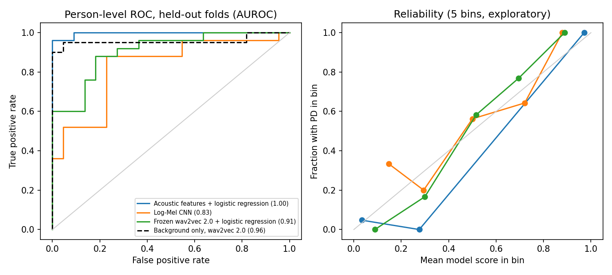

# Final Report: Sustained-Vowel Models on Italian PVS

This is a research comparison. Nothing here is a diagnostic or screening result, and
model outputs are scores, not probabilities of disease.

## Summary

Three models were asked to separate people with Parkinson's disease (PD) from elderly
healthy controls using sustained-vowel recordings of people they had never seen. All
three do so well above chance. That result cannot be attributed to the voice: a
classifier given only the non-speech background of the same recordings separates the
groups about as well as the best model (AUROC 0.96 to 0.97). The two groups were
recorded under different conditions, and this dataset cannot tell voice differences
apart from recording differences.

## Data

Italian Parkinson's Voice and Speech (Dimauro and Girardi 2019, CC BY 4.0).

| Step | Count |
|---|---|
| WAV files downloaded | 831 |
| Recordings in the manifest (elderly healthy and PD groups) | 786 |
| People | 47 (22 healthy, 25 PD) |
| Sustained-vowel recordings | 495 |
| Dropped: under 3 s after silence trimming | 1 (PD) |
| Clips used | 494 (220 healthy, 274 PD) |

| Group | Women | Men | Clips per person (min / median / max) |
|---|---|---|---|
| Healthy | 12 | 10 | 10 / 10 / 10 |
| PD | 9 | 16 | 4 / 10 / 20 |

The 15 young healthy controls in the source are excluded so age does not separate the
groups. Every clip is mono, 16 kHz, the middle 3 s of the voiced region, peak-scaled to
0.9. All 220 healthy clips and 174 PD clips were recorded at 16 kHz; 100 PD clips from
10 people were recorded at 44.1 kHz and resampled.

## Method

- **Unit of analysis:** the person. Clip scores are averaged per person before any
  metric, so repeated vowels count once.
- **Evaluation:** 5 participant-grouped folds. Each person is scored by a model that
  never saw any of their clips. There is no separate test set; with 47 people one would
  be too small to be informative.
- **Tuning:** inside each training fold only, on further participant-grouped splits.
- **Threshold:** 0.5, fixed in advance.
- **Uncertainty:** 2000 participant bootstrap replicates, resampled within class,
  percentile 95% intervals. Model differences use the same resample for both models.

| Model | Input | Classifier | Selected per fold |
|---|---|---|---|
| Acoustic | 39 values: pitch, jitter, shimmer, HNR (Praat); 13 MFCC means and SDs | Class-balanced logistic regression | C = 10, 10, 1, 10, 10 |
| Log-Mel CNN | 64-band log-Mel, per-clip standardized | 3 conv blocks, 23,585 parameters, training-only gain and noise augmentation | Epoch 11, 1, 2, 9, 6 |
| wav2vec 2.0 | 768-value mean-pooled embedding from the frozen `facebook/wav2vec2-base` encoder | Class-balanced logistic regression | C = 0.1, 0.01, 1, 10, 10 |

All settings are in [DL-004](decision-log.md#dl-004-model-settings-and-evaluation-protocol).
They were fixed before held-out scores were computed and not changed afterwards. The
CNN trained on CPU in about 2 minutes for all five folds.

## Results

Person-level, held-out folds, 47 people (25 PD).

| Model | AUROC (95% CI) | Balanced accuracy (95% CI) | Sensitivity | Specificity | Precision | F1 | TN/FP/FN/TP | Brier | ECE |
|---|---|---|---|---|---|---|---|---|---|
| Acoustic features + logistic regression | 0.996 (0.984-1.000) | 0.980 (0.940-1.000) | 0.96 | 1.00 | 1.00 | 0.98 | 22/0/1/24 | 0.020 | 0.033 |
| Log-Mel CNN | 0.829 (0.696-0.933) | 0.726 (0.595-0.838) | 0.68 | 0.77 | 0.77 | 0.72 | 17/5/8/17 | 0.188 | 0.087 |
| Frozen wav2vec 2.0 + logistic regression | 0.905 (0.811-0.976) | 0.849 (0.738-0.937) | 0.88 | 0.82 | 0.85 | 0.86 | 18/4/3/22 | 0.140 | 0.093 |

| Paired AUROC difference | Estimate (95% CI) |
|---|---|
| Acoustic minus CNN | +0.167 (+0.065 to +0.293) |
| Acoustic minus wav2vec 2.0 | +0.091 (+0.024 to +0.178) |
| CNN minus wav2vec 2.0 | -0.076 (-0.175 to +0.005) |

On these recordings the acoustic model ranks above both others, and the CNN and
wav2vec 2.0 models are not distinguishable. The next section explains why this ranking
is not a statement about which representation captures PD-related voice changes.



Calibration is assessed on 47 held-out scores in 5 bins and is exploratory. No
recalibration was applied.

## The recording-condition confound

Each control below uses the same nested cross-validation as the models.

| Check | People | AUROC (95% CI) |
|---|---|---|
| Background only, MFCC means + logistic regression | 42 | 0.973 (0.909-1.000) |
| Background only, wav2vec 2.0 + logistic regression | 42 | 0.957 (0.864-1.000) |
| Acoustic model, MFCC features only | 47 | 0.998 (0.989-1.000) |
| Acoustic model, Praat voice measures only | 47 | 0.918 (0.822-0.989) |
| Acoustic model, originally-16 kHz recordings only | 40 | 1.000 (1.000-1.000) |
| Acoustic model, originally-16 kHz, Praat measures only | 40 | 0.980 (0.937-1.000) |
| Acoustic model, women | 21 | 0.991 (0.944-1.000) |
| Acoustic model, men | 26 | 1.000 (1.000-1.000) |
| Acoustic model, labels shuffled between people (20 runs) | 47 | mean 0.497, max 0.727 |

"Background only" means every voiced stretch, plus 0.1 s on each side, is removed from
the raw recording and the classifier sees what is left. Five PD participants have under
0.25 s of such audio and are not covered. On the 42 covered people the three voice
models score 0.995, 0.825 and 0.895.

What this shows:

- Audio with no voice in it separates the groups at AUROC 0.96 to 0.97. The groups
  differ in room, microphone, or procedure.
- The effect is not the sample-rate difference: it persists on 16 kHz recordings alone.
- The evaluation is not leaking: shuffled labels fall to chance.
- The model ranking follows how much recording information each input keeps. MFCC
  summaries keep the spectral envelope of the channel. The CNN standardizes each clip
  and is trained with gain and noise changes, and wav2vec 2.0 normalizes its input,
  which removes part of it. This is an interpretation consistent with the numbers; it
  was not tested directly.

The Praat-only model (0.918) uses measures of vocal fold periodicity that should
depend less on the channel, but jitter, shimmer and HNR also change with background
noise, so it is not a clean voice-only estimate either.

## What can and cannot be claimed

Supported:

- On Italian PVS, all three models separate the PD and healthy groups in unseen people
  above chance, with the intervals above.
- Recording conditions alone separate the groups at least as well as two of the three
  models and within the interval of the third.

Not supported:

- That any model detects Parkinson's-associated voice patterns.
- That one representation is better than another for PD-related voice analysis.
- Any performance estimate for other recordings, devices, languages or populations.
- Any diagnostic, screening or clinical use.

## Limitations

- **Confounding by recording condition**, as above. This is the dominant limitation.
- **Sample size:** 47 people. Intervals are wide, and CNN early stopping relied on
  validation groups of about 9 people; in two folds validation AUROC was already 1.0
  after the first or second epoch.
- **Background check:** 0.1 s margins may leave faint breath or vowel decay in the
  "background" audio. The segments were not auditioned.
- **Labels and cohort:** clinical details, disease stage, medication state and
  recruitment are not available in the release. Groups differ in sex balance.
- **Task scope:** sustained vowels only, Italian speakers only.
- **Bootstrap:** intervals resample people but not the fold assignment or training
  randomness; the CNN was run with one seed.

## Demo

Not built. A demo would show a score that mostly reflects the recording setup. See
[DL-005](decision-log.md#dl-005-recording-condition-confound-and-demo-decision); the
decision needs confirmation from the project owners.

## Reproducing

```sh
uv sync --frozen --all-groups
uv run python scripts/00_download.py
uv run python scripts/01_manifest.py
uv run python scripts/02_folds.py
uv run python scripts/03_clean_vowels.py
uv run python scripts/04_acoustic_features.py
uv run python scripts/05_acoustic_baseline.py
uv run python scripts/06_acoustic_robustness.py
uv run python scripts/07_cnn.py
uv run python scripts/08_wav2vec.py
uv run python scripts/09_compare.py
```

Results land in `artifacts/`, which is git-ignored along with `data/`. Person IDs are
derived from file-name codes and appear only in those ignored files. The numbers above
were produced on Linux x86-64, CPU only, with the versions in `uv.lock`. Rerunning the
CNN on the same machine reproduces its person-level scores; other hardware may differ
in the last digits.
